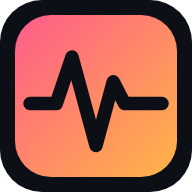

<p align="center">
  
</p>

<h1 align="center">PulseForge Studio</h1>
<p align="center"><b>A free, open-source music studio that runs on any device: browser, Windows, macOS, Linux, ChromeOS, iPhone, iPad and Android.</b><br>
No account, no install required, no paywalled features. Your projects stay on your device.</p>

---

## 📖 User Guide

### 1. Quick start (60 seconds)

1. **Open the app** (see [Installation](#-installation) below). A demo song is loaded for you.
2. Press **Space** (or ▶) to play. Click **SONG** to hear the full arrangement, or **PAT** to loop one pattern.
3. In the **Channel Rack**, click squares to toggle drum steps. Drag across them to paint, and right-click to erase.
4. Click a channel name to select it, then draw notes in the **Piano Roll**. Stuck for ideas? Press **✨ Melody**, **✨ Chords** or **✨ Groove**.
5. Paint your patterns into the **Playlist** to arrange a full song.
6. Shape the sound in the **Mixer** with EQ, compressor, reverb, delay, distortion, filter, chorus, bitcrusher and stereo widener.
7. **File → Export WAV** to render your track. Your work also **autosaves** in the browser continuously.

### 2. The dynamic workspace

Every panel (Browser, Playlist, Channel Rack, Piano Roll, Mixer) is a **floating window**:

- **Drag** it by its title bar. It **snaps** to other windows and to the workspace edges.
- **Resize** it from the bottom-right corner. **Double-click** the title to maximize it, and click ✕ to hide it.
- Use the ready-made layouts under **View**: *Studio*, *Beat making*, *Compose*, *Arrange* and *Mixing*.
- Your layout is remembered between sessions.
- On **phones and small tablets**, the panels become full-screen tabs along the bottom of the screen.

### 3. How it all fits together

| Concept | What it is |
|---|---|
| **Channel** | An instrument: synthesized drums (kick, snare, clap, hats, tom, rim, perc), subtractive synths, FM synths, or a **sampler** for your own audio files or microphone recordings. Double-click a channel to edit its sound. |
| **Pattern** | A clip of notes for all channels. The rack's step buttons and the piano roll edit the *same* notes. |
| **Playlist** | Places patterns over time on tracks. **PAT** mode loops the current pattern; **SONG** mode plays the playlist. Click the ruler to play from that bar. |
| **Mixer** | Each channel routes to an insert track (the number next to the channel name). Each insert has volume, pan, mute/solo, a meter and its own effect chain, and all inserts feed the **Master**. |

### 4. Feature list

- 🥁 **Step sequencer** with paint-drag, per-step velocity (mouse wheel), swing and 16–64 step patterns
- 🎹 **Piano roll**: draw, select, erase and pan tools; snap from 1/4 step to 1 bar; **scale highlighting + scale lock**; **chord stamps**; velocity lane; ghost notes; quantize; transpose; duplicate
- ✨ **Idea generators**: drum grooves (house, techno, trap, breakbeat), melodies in your scale, and chord progressions
- 🔊 **Instruments**: 8 synthesized drum voices (TR-style), supersaw / bass / 808 / pad / pluck / square synths, FM bell and e-piano, and a sampler with pitch tracking, reverse and one-shot/gate modes
- 🎚 **Mixer**: unlimited insert tracks, peak meters, a live spectrum analyzer, and 9 effects (EQ, compressor, reverb, delay with tempo sync, distortion, filter, chorus, bitcrusher, stereo widener). The master bus has a limiter and a soft clipper, so output never exceeds full scale.
- 🎼 **Playlist arranger** with paint/move/resize/erase, track mute and play-from-bar
- 🎤 **Recording**: record your microphone straight into a sampler channel, and record notes from your computer keyboard or a **MIDI controller** (Web MIDI)
- 💾 **Files**: autosave, `.pfproj` project files (samples embedded), **WAV export**, **MIDI export**, and drag-and-drop audio or projects anywhere in the window
- ⌘ **Command palette** (Ctrl/⌘ + K) to search every action, plus full **undo/redo**
- 🌓 Light and dark themes, and touch-friendly controls
- 📴 **Works offline** once loaded (Progressive Web App)

### 5. Keyboard shortcuts

| Keys | Action |
|---|---|
| `Space` | Play / stop |
| `Shift + L` | Switch Pattern ↔ Song mode |
| `Shift + R` | Toggle note recording |
| `Shift + M` | Toggle metronome |
| `Ctrl/⌘ + Z` · `Ctrl/⌘ + Shift + Z` | Undo · Redo |
| `Ctrl/⌘ + S` · `Ctrl/⌘ + O` | Save · Open project file |
| `Ctrl/⌘ + E` | Export WAV |
| `Ctrl/⌘ + K` | Command palette |
| `F5` `F6` `F7` `F8` `F9` | Playlist · Channel Rack · Piano Roll · Browser · Mixer |
| `F1` | User guide |
| `Z S X D C V G B H N J M` / `Q 2 W 3 E R 5 T 6 Y 7 U I` | Play notes on the selected channel (two octaves). Toggle in **Tools → Typing keyboard** |
| `[` `]` | Previous / next pattern |
| Piano roll: `Delete`, `Ctrl+A`, `Ctrl+D` | Delete, select all, duplicate selection |
| Piano roll: `↑` `↓` (`Shift` = octave), `←` `→` | Transpose / nudge selected notes |
| Piano roll / playlist: `Ctrl + wheel` | Zoom |

---

## 🚀 Installation

PulseForge is a static web app with **no build step**, so it can run in any of these ways.

### 🌐 Option A: Use it in a web browser (no install)
Open the hosted site (once published, see [Hosting](#-hosting-your-own-copy)). It works in Chrome, Edge, Brave, Firefox and Safari 16+. Chrome and Edge give the best audio performance and MIDI support.

### 💻 Option B: Install as an app on Windows, macOS, Linux or ChromeOS (recommended)
1. Open the site in **Chrome**, **Edge** or **Brave**.
2. Click the **install icon** (⊕) in the address bar, or **⋮ → Cast, save and share → Install PulseForge** (Edge: **… → Apps → Install**).
3. PulseForge appears in your Start menu / Applications / launcher, opens in its own window and **works offline**.

### 📱 Option C: iPhone and iPad
1. Open the site in **Safari**.
2. Tap **Share** → **Add to Home Screen** → **Add**.
3. Launch it from the home screen icon to use it full-screen. *Tip: switch off silent mode to hear audio.*

### 🤖 Option D: Android
1. Open the site in **Chrome**.
2. Tap **⋮ → Install app** (or **Add to Home screen**).

### 🖥 Option E: Native desktop app (Electron)
Requires [Node.js](https://nodejs.org) 18+.
```bash
git clone https://github.com/<your-username>/PulseForge.git
cd PulseForge
npm install
npm run desktop        # launch the desktop app
npm run dist           # build an installer for your OS (.dmg / .exe / AppImage / .deb) into dist/
```
Platform-specific installers: `npm run dist:mac`, `npm run dist:win` or `npm run dist:linux`.

### 🏠 Option F: Run it locally from source
```bash
git clone https://github.com/<your-username>/PulseForge.git
cd PulseForge
npx serve .            # or: python3 -m http.server 3000
```
Then open the printed address (for example `http://localhost:3000`). The app must be served over `http://localhost` or `https://`. Opening `index.html` directly as a file will not work, because browsers block ES modules on `file://`.

---

## 🌍 Hosting your own copy

Any static host works: GitHub Pages, Netlify, Vercel, Cloudflare Pages, or your own server. Upload the repository as-is; there is nothing to build.

**GitHub Pages:** go to the repository's **Settings → Pages → Build and deployment**, set *Source* to **Deploy from a branch**, then choose **main** and **/ (root)**. The site will be live at `https://<your-username>.github.io/PulseForge/`. (On a free GitHub account, Pages needs the repository to be public.)

## 🔒 Privacy

PulseForge has no servers, accounts, analytics or tracking. Projects autosave to your browser's local storage, imported samples are kept in IndexedDB on your device, and `.pfproj` files are saved wherever you choose.

## 🧱 Project structure

```
index.html              App shell
css/style.css           Theme, layout, responsive/mobile styles
js/app.js               App controller: state, undo, files, keyboard, MIDI, menus
js/state.js             Project model, presets, demo song
js/audio/engine.js      Audio graph, lookahead scheduler, offline WAV render, MIDI export
js/audio/instruments.js Drum synthesis, subtractive + FM synths, sampler
js/audio/effects.js     Insert effects
js/audio/samples.js     Sample bank (IndexedDB persistence)
js/ui/*.js              Windows manager, channel rack, piano roll, playlist, mixer, browser, editor, guide
sw.js, manifest.webmanifest   Offline / installable PWA
desktop/main.js         Electron desktop wrapper
```

## 🗺 Roadmap ideas

Automation clips, audio clips on the playlist, VST-style plugin API (WebAssembly), time-stretching, stem export, and real-time collaboration. Contributions are welcome.

## 🤝 Contributing

Pull requests are welcome. The code is plain modern JavaScript with no framework and no build step: edit a file and refresh the page.

## 📄 License

[MIT](LICENSE): free to use, modify and share, for everyone.

> PulseForge Studio is an independent project and is not affiliated with or endorsed by Image-Line or FL Studio.
